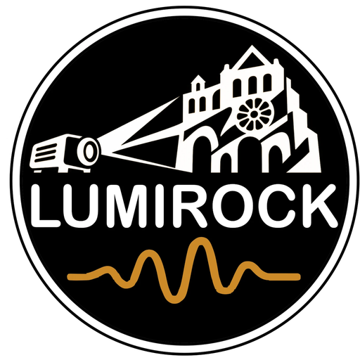

<p align="center"></p>

<h1 align="center">LUMIROCK</h1>
<p align="center"><em>by Arnisound tools</em> · <a href="https://arnisound.github.io/LUMIROCK/">Ouvrir l'application</a></p>

**Faites parler les pierres.** Lumirock transforme la photo d'un monument en spectacle de *video mapping*, prêt à projeter — directement dans le navigateur, sans rien installer, sans serveur, pour 0 €.

Il produit des médias destinés aux professionnels du mapping (Resolume, MadMapper, Modulo Pi, Millumin…), qui recalent ensuite l'image sur la façade, ainsi qu'un **kit pro** pour retravailler le spectacle dans After Effects ou DaVinci Resolve.

## Le parcours en 5 étapes

| Étape | Ce qu'on fait |
|---|---|
| **1. Monument** | Importer une photo de façade, ou partir d'un monument modèle (église gothique, hôtel de ville, château fort) avec ses calques déjà prêts. |
| **2. Redressement** | Placer 4 coins (avec loupe) : la façade est mise à plat, comme vue parfaitement de face. Dimensions réelles optionnelles pour des proportions exactes. |
| **3. Calques** | Détourer fenêtres, portes, rosace, colonnes, corniches, statues… Outils rectangle, arc plein cintre, arc gothique, ellipse, polygone, miroir. Détection automatique des ouvertures. Profondeur calculée par IA (Depth Anything V2, dans le navigateur). |
| **4. Spectacle** | Composer avec 29 tableaux, 6 scénarios (Noël, Patrimoine, Halloween, Fête nationale, Quatre saisons, Mariage) ou « Surprends-moi ». Musique avec détection du tempo, effets qui pulsent sur le rythme, calage des tableaux sur les mesures. Ligne de temps, transitions, réglages fins. |
| **5. Export** | Vidéo MP4 (jusqu'à 4K, 25 à 60 i/s, avec la musique), un fichier par tableau pour le direct, kit pro (.zip), gabarits de calage, projection plein écran depuis le navigateur. |

## Les tableaux

- **Lumière** : Allumage, Course du soleil (ombres qui tournent), Faisceaux fantômes, Orage, Mille bougies
- **Architecture** : Dessin d'architecte, Pierres vivantes (extrusion), Effondrement / reconstruction, Relief vivant 3D (parallaxe), Puzzle, Scan laser
- **Matières** : Vitrail, Transmutation (or, marbre, glace, cuivre), Mosaïque
- **Nature** : Montée des eaux, Embrasement, Nuit de neige, Jardin suspendu, Aurore boréale
- **Graphique** : Squelette néon, Vague de couleurs, Battements, Kaléidoscope, Glitch, Feux d'artifice
- **Illusions** : Fenêtres sur l'ailleurs, Lever de rideau, Texte lumineux / gravé, Théâtre d'ombres

Chaque tableau calcule la **lumière à projeter** (pas une image « collée ») : la vue *Simulation nuit* montre fidèlement ce que verra le public, la vue *Projection* montre ce qui sort du vidéoprojecteur.

## Le kit pro

`facade_redressee.png`, `profondeur.png`, `normales.png`, `contours_pierre.png`, `contours_calques.png`, un masque PNG par calque, `contours.svg`, `gabarit_calage.png`, `gabarit_calage_noir.png` (à projeter pour caler le maillage), `projet.json` et un guide d'utilisation pour chaque logiciel.

## Développement

```bash
npm install
```

```bash
npm run dev
```

```bash
npm run build
```

Le site statique est généré dans `dist/`. Le workflow `.github/workflows/deploy.yml` le construit à chaque push sur `main` et le publie sur la branche `gh-pages`. Réglage GitHub Pages : *Settings → Pages → Deploy from a branch → `gh-pages` / `(root)`* (le mode *GitHub Actions* fonctionne aussi).

### Architecture

- `src/gl/` — moteur de rendu WebGL2 (effets, transitions, halo lumineux, simulation de nuit)
- `src/effects/library.ts` — la bibliothèque de tableaux (shaders GLSL + paramètres)
- `src/analysis/` — redressement (homographie), cartes de calques / profondeur / normales / contours, détection des ouvertures, profondeur IA
- `src/audio.ts` — analyse musicale (forme d'onde, énergie, tempo, parties)
- `src/scenarios.ts` — scénarios et composition automatique
- `src/export/` — export vidéo (WebCodecs via Mediabunny), kit pro, fichiers `.lumirock`
- `src/ui/` — scène, éditeurs (coins, calques), ligne de temps
- `src/templates.ts` — monuments modèles générés procéduralement

### Briques open source utilisées

| Brique | Licence | Usage |
|---|---|---|
| [Mediabunny](https://github.com/Vanilagy/mediabunny) | MPL-2.0 | Encodage MP4 dans le navigateur |
| [fflate](https://github.com/101arrowz/fflate) | MIT | Archives .zip |
| [Transformers.js](https://github.com/huggingface/transformers.js) | Apache-2.0 | IA dans le navigateur |
| [Depth Anything V2 Small](https://github.com/DepthAnything/Depth-Anything-V2) | Apache-2.0 | Estimation de profondeur |

Aucune donnée n'est envoyée sur un serveur : photos, musiques et projets restent sur l'ordinateur de l'utilisateur (sauvegarde automatique dans le navigateur, fichiers `.lumirock` à enregistrer).

### Navigateurs

Chrome ou Edge recommandés (WebGL2 + WebCodecs pour l'export vidéo). Firefox et Safari récents fonctionnent pour la création ; l'export dépend de leur prise en charge de WebCodecs.
